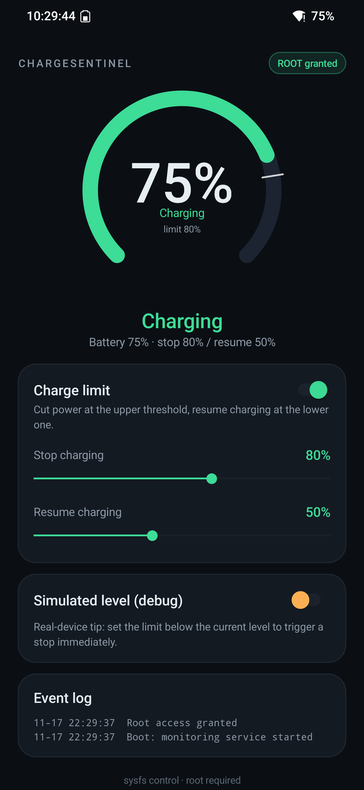

<p align="center">
  
</p>

<p align="center">
  
  
  
  <a href="https://github.com/Dynesshely/ChargeSentinel/actions/workflows/ci.yml"></a>
  
  
  
  
</p>

# ChargeSentinel

**Stop charging at 80%. Resume at 50%.** A tiny, dependency-free Android app that keeps your battery inside a healthy
window — and keeps it there even when the charger driver tries to take the decision back.

<p align="center">
  
</p>

## Introduction

Lithium-ion batteries age fastest when they sit at 100% while plugged in. Many ROMs ship a charge limit, but it is
either missing, buried in vendor code, or silently ignored by the charger driver. ChargeSentinel does one thing and
does it in the most direct way available on Android: with **root**, it flips the kernel's charging switches, and it
keeps flipping them as long as the limit is enabled.

- **Hysteresis instead of a single cutoff.** Charging stops at the upper threshold (default **80%**) and does not
  restart until the battery falls to the lower one (default **50%**). No flip-flopping around a single number.
- **Self-healing control.** The service re-reads the real sysfs nodes every 10 seconds and rewrites them whenever the
  charger driver resets them. One-shot writes are not enough on several Qualcomm/OnePlus kernels.
- **Explicit state, not hope.** Suspending requires *both* control nodes to be in the "stop" position; a mismatch is
  treated as a failure and corrected on the next tick.
- **Foreground service + notification.** Current level, current state, and a one-tap "turn off limit" action.
- **Survives reboots.** If the limit is on, the service comes back after boot and re-evaluates the battery.
- **Debug simulation.** Feed the policy a fake level from the UI to test the 80/50 transitions on a real device
  without waiting for hours of discharge.
- **Zero third-party dependencies.** Plain Java 17, framework widgets, no AppCompat, no Compose, no Material — the
  debug APK is under 100 KB.

Requires **root** (Magisk, KernelSU, …). Without root the app still runs but can only display the battery level.

## How to install

### Requirements

| Item | Requirement |
| --- | --- |
| Android | 10 or newer (minSdk 30), tested on Android 14 |
| Root | Magisk / KernelSU / any `su` that can write `/sys/class/power_supply` |
| Build | JDK 17 and Android SDK Platform 34 (only if building from source) |

### Build from source

```bash
git clone https://github.com/Dynesshely/ChargeSentinel.git
cd ChargeSentinel

# point Gradle at your SDK
echo "sdk.dir=$ANDROID_HOME" > local.properties

./gradlew assembleDebug
# APK: app/build/outputs/apk/debug/app-debug.apk
```

On Windows use `gradlew.bat`; set `JAVA_HOME` to a JDK 17 installation first.

### Install on the phone

Grab the APK from the [Releases](https://github.com/Dynesshely/ChargeSentinel/releases) page, or install the one you
just built:

```bash
adb install -r app/build/outputs/apk/debug/app-debug.apk
```

Then:

1. Open **ChargeSentinel** and allow notifications when asked (Android 13+). Without the notification the foreground
   service still works, you just cannot see its status.
2. Flip **Charge limit** on. Magisk asks for superuser permission the first time — grant it permanently.
3. Set **Stop charging** / **Resume charging** to the window you want. Defaults are 80% / 50%; the resume value is
   always kept at least 5 points below the stop value.

Every `v*` tag is built and published automatically by GitHub Actions. Release APKs are signed with the standard
Android debug key, so they are meant for sideloading rather than store distribution.

## How it works

Android has no public API to stop charging, so ChargeSentinel writes the kernel's `power_supply` attributes through
`su`.

| Node | Write | Meaning |
| --- | --- | --- |
| `/sys/class/power_supply/battery/mmi_charging_enable` | `0` / `1` | Disable / allow charging (primary switch, survives on tested devices) |
| `/sys/class/power_supply/battery/input_suspend` | `1` / `0` | Cut / restore input power (immediate, but reset periodically by the charger driver) |

Nodes that turned out to be useless on the tested device:

- `charge_control_limit` — read-only on this kernel (`-r--r--r--`).
- `/sys/class/qcom-battery/restrict_chg` — writable and sticky, but it does not change the charge voltage/current.

### The hysteresis loop

```text
        stop threshold (80%)
   ────────────┬────────────   level >= stop   -> suspend charging
               │
               │  hold the current state
               │
   ────────────┴────────────   level <= resume -> allow charging
        resume threshold (50%)
```

Every 10 seconds the foreground service:

1. reads the battery level (or the simulated level, in debug mode),
2. asks `ChargePolicy` for a decision (`SUSPEND` / `RESUME` / `HOLD`),
3. calls `ChargeControl.apply(wantSuspended)`, which reads the two nodes, writes only what is out of place, and
   returns the resulting state,
4. logs a transition only when the state actually changed.

Because step 3 runs on every tick and is idempotent, a driver reset is repaired within one interval. That is the whole
trick: **one `su` per tick, always re-asserting the desired state.**

### Checking that it really stops

Look at the battery voltage, not at the node:

- charging: `voltage_now` ≈ 4.39 V (charger float voltage)
- suspended: `voltage_now` relaxes to 4.08–4.27 V

## How to contribute

Issues and pull requests are welcome.

- **Bug reports** — please include the Android version, device model, kernel/ROM, root solution, and the values of
  `mmi_charging_enable` / `input_suspend` (if present). That is usually enough to tell whether the node set needs to
  be extended.
- **Porting to another device** — node paths live in `SysfsChargeControl`; a PR that turns them into a per-device table
  would be very welcome.
- **Code** — plain Java 17, no new dependencies. Keep the policy logic inside `ChargePolicy` (it is unit-tested and
  must stay Android-free), keep UI text in `strings.xml`, and run the checks before opening a PR:

  ```bash
  ./gradlew testDebugUnitTest assembleDebug
  ```

- **Commit style** — short imperative subject lines, Chinese or English both fine.
- Please do not commit personal data: real device IPs, adb ports, logs from your own phone, or anything from the
  workspace-level `.meta` folder.

## Structure

```text
ChargeSentinel/
├── .github/workflows/             # CI (build + unit tests) and tag-triggered release
├── app/
│   ├── build.gradle.kts
│   └── src/
│       ├── main/
│       │   ├── AndroidManifest.xml
│       │   ├── java/top/dynesshely/chargesentinel/
│       │   │   ├── core/          # pure logic + sysfs control
│       │   │   │   ├── ChargePolicy.java       # hysteresis and clamp rules (unit-tested)
│       │   │   │   ├── ChargeState.java        # ALLOWED / SUSPENDED / MIXED / UNKNOWN
│       │   │   │   ├── ChargeControl.java      # control abstraction
│       │   │   │   ├── SysfsChargeControl.java # root + sysfs, one su per call
│       │   │   │   └── BatteryInfo.java        # battery level / plugged state
│       │   │   ├── data/          # persistence
│       │   │   │   ├── Settings.java
│       │   │   │   └── EventLog.java
│       │   │   ├── service/       # foreground service + boot receiver
│       │   │   │   ├── ChargeService.java
│       │   │   │   └── BootReceiver.java
│       │   │   └── ui/            # activity, gauge, view helpers
│       │   │       ├── MainActivity.java
│       │   │       ├── BatteryGaugeView.java
│       │   │       └── UiKit.java
│       │   └── res/               # strings (en / zh-CN), theme, icons
│       └── test/java/.../core/ChargePolicyTest.java
├── docs/                          # animated SVG banner + screenshot used by this README
├── gradle/libs.versions.toml
├── LICENSE
└── README.md
```

## Stars History

Dark mode is what this README uses; the light variant is kept for light-mode viewers.

<picture>
  <source media="(prefers-color-scheme: dark)" srcset="https://api.star-history.com/svg?repos=Dynesshely/ChargeSentinel&type=Date&theme=dark">
  <source media="(prefers-color-scheme: light)" srcset="https://api.star-history.com/svg?repos=Dynesshely/ChargeSentinel&type=Date">
  
</picture>

## License

[MIT](LICENSE) © 2026 Dynesshely
